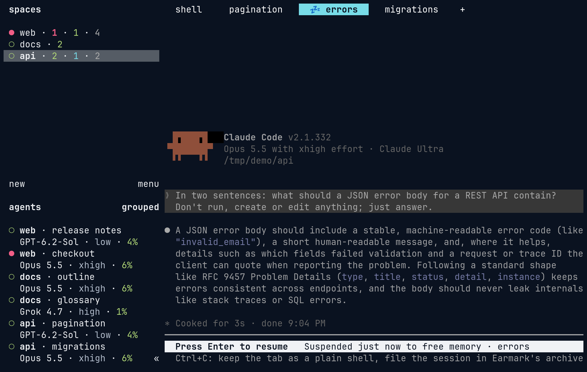
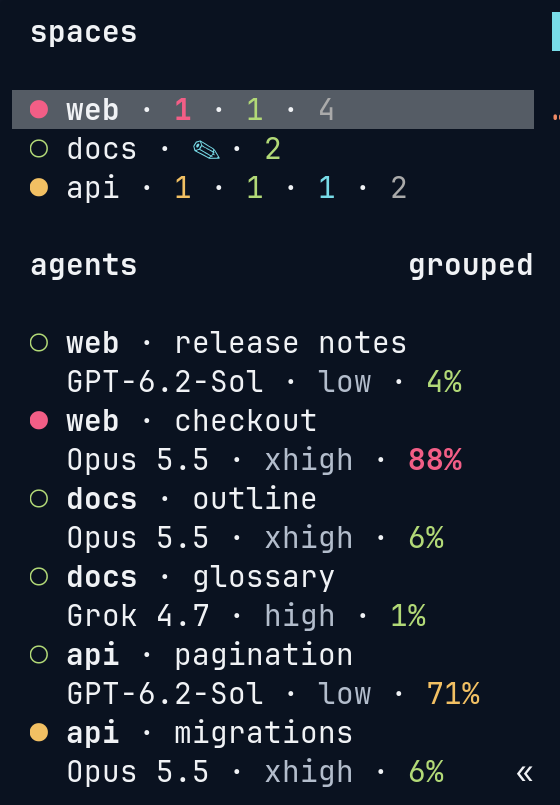

<h1 align="center">
  <picture>
    <source media="(prefers-color-scheme: dark)" srcset="branding/eartag/lockup-dark.svg">
    
  </picture>
</h1>

**Closed agent sessions, filed under their [Herdr](https://herdr.dev) workspace and ready to reopen.** An archive per workspace · reopen in one click · bring back whole workspaces · suspend idle tabs to free memory · a note for each workspace · model, effort and context use in Herdr's sidebar · Claude Code, Codex, Grok and the other agents Herdr knows

![Herdr with Earmark: the archive popup over a workspace called web lists four closed sessions (tab names in bold, each agent's own title dimmed, the agent, and when it was last active, from 29 min ago to yesterday). In the sidebar, each workspace's name is followed by coloured counts (needs input in red, working in yellow, done in green, suspended in blue, archived dimmed, a pencil for a note), and each agent's second line shows its model, effort and context use, such as Opus 5.5 · xhigh · 88% in red](media/hero.png)

Herdr keeps your coding agents in workspaces and tabs. Close a tab, though, and its conversation is gone from Herdr: you're left digging for a session id, and the agent's own resume picker lists sessions by folder, not by the Herdr workspace you were working in. Earmark keeps every closed session filed under its workspace, so one key shows that workspace's archive and Enter brings a conversation back. It also keeps a note for each workspace, written by you or by a Claude session in it, and fills Herdr's sidebar with what you'd otherwise go tab by tab to find out: which agents need you, which are working, and how full each one's context is. To earmark something is to set it aside for later; an earmark is also the notch a shepherd cuts to show whose flock a sheep belongs to.


## What you get

- **An archive for each workspace.** Close a tab running an agent, or `/exit` the agent, and its session is filed under the Herdr workspace it was in. Archives go by workspace name, so a workspace you close and open again later gets its archive back.
- **Reopen in one click.** Ctrl+Space then `a` lists this workspace's closed sessions, newest first. Enter or a double-click opens the session in a new tab with its old name, resuming the conversation where it stopped.
- **Bring back a closed workspace.** Ctrl+Space then Shift+A lists the workspaces you've closed. Restoring one brings back the tabs it had when you closed it, in order, with their names and folders, plain tabs included, and every agent tab resumes its session. Its older archived sessions stay in the archive, so a workspace with 5 open tabs and 70 archived sessions comes back as 5 tabs.

  

- **Suspend idle tabs to free memory.** Each coding agent holds a few hundred MB while it waits. Suspending one ends the agent and keeps its tab where it was, marked 💤, showing the agent's last screen dimmed with "Press Enter to resume"; Enter brings the same conversation back in the same tab, with the options it was started with that Earmark knows (Claude Code and Codex; Claude in the permission mode it was in when it stopped, read from what Claude writes as it exits, and never in auto or bypass mode on a guess; see Known limits). Suspend a tab with a key (Ctrl+Space then Ctrl+S), or let Earmark do it after an hour idle, when memory runs low, or for all but the most recently used agents. It's off until you turn it on, and it never suspends an agent that's working, running a command, waiting on a Claude `/loop` wake-up or scheduled task (including one saved to survive restarts), or holding text you haven't sent, nor one where Claude's own record of the process names a different conversation than Herdr shows. Where it can't read an agent's prompt, can't tell what the agent is doing, or doesn't know an option it was started with, automatic suspends leave it alone, and the key asks first: its answers come in a small Earmark popup (Herdr's own notifications are off by default), and only `y` then Enter there suspends it anyway (or, with `messages = "toast"`, Herdr's toasts and a second press).

  
- **A note for each workspace.** Ctrl+Space then `i` shows this workspace's note: where the project stands, what's next, what you're waiting on, whatever you'd want to read when you come back to it. `e` edits it in your editor, and `u` asks a Claude session in the workspace to bring it up to date with the `/herdr-note` skill (which you can also type in any Claude session, with or without instructions after it). A note goes with its workspace when you close it and comes back when you restore it; a closed workspace that holds a note is kept (marked ✎ in the Workspaces view) until you forget it there.

  
- **What each agent is running, in the sidebar.** The line under each agent in Herdr's Agents panel shows its model, its effort and how full its context is, `Opus 5.5 · xhigh · 9%`, the number coloured as it fills (yellow from 70%, red from 85%, violet from 95%). Claude Code's come from its status line, live; Codex's and Grok's from their own files, after each turn. When the line is too long for the sidebar, the effort shortens first, then the model (`O5.5 · xh · 96%`); the number always stays.
- **Counts on each workspace.** After each workspace's name: agents that need you, agents working, agents done, suspended tabs and archived sessions, each in its own colour, zeros left out: `● web · 1 · 2 · 27`. What doesn't fit goes from the right, so the name keeps its room (see Known limits for how Earmark knows the width). Pick which counts show and in what order, or put them on a line of their own.

  
- **Your names first.** Each session shows the name you gave its tab (or pane) in bold, with the agent's own title for the session beside it. Reopening gives the tab its name back.
- **Mouse and keyboard.** Click to select, double-click to open, scroll with the wheel, click a row's × to forget it (with Forget and Keep buttons to confirm). Or arrows, Enter, Delete, `/` to filter, Tab to switch between Sessions and Workspaces.
- **Follows each agent's own housekeeping.** For Claude Code, Codex and Grok, Earmark reads the agent's own files (never writes them) for the title, the last activity and whether the session still exists. A session stays in the archive as long as the agent keeps it, and leaves when the agent deletes it, so the archive never offers a dead session.
- **Restarts are safe.** Restarting Herdr's server, or a reboot, doesn't archive anything: Herdr restores those tabs itself.
- **No daemon.** Earmark is a few short Herdr hooks and a popup, in plain Python with no dependencies. With suspending on, a hook also starts a check at most once a minute, which exits when it's done (it takes longer when it suspends tabs: up to about 30 seconds for each), and each suspended tab runs a small placeholder (about 20 MB) until it's resumed.

## Install

```bash
herdr plugin install cwilliams5/herdr-earmark
```

Then bind the archive to keys in Herdr's config (`~/.config/herdr/config.toml`) and run `herdr server reload-config`. `prefix` is Herdr's prefix key: Ctrl+B unless you've changed it; this page writes Ctrl+Space, the prefix Omarchy sets up.

```toml
[[keys.command]]
key = "prefix+a"
type = "plugin_action"
command = "io.github.cwilliams5.earmark.open"
description = "Earmark: archived sessions"

[[keys.command]]
key = "prefix+shift+a"
type = "plugin_action"
command = "io.github.cwilliams5.earmark.open-workspaces"
description = "Earmark: closed workspaces"
```

Any free key works; `prefix+a` and `prefix+shift+a` are unused in Herdr's default keys.

To suspend idle tabs, turn it on in Earmark's `config.toml` (`herdr plugin config-dir io.github.cwilliams5.earmark` prints the folder) and bind the key that suspends the tab in view, or resumes it:

```toml
[suspend]
when = "time"        # or "manual" (the key only), "memory", "count"; "off" by default
idle_minutes = 60
```

```toml
[[keys.command]]
key = "prefix+ctrl+s"
type = "plugin_action"
command = "io.github.cwilliams5.earmark.suspend"
description = "Earmark: suspend or resume this tab"
```

That's the prefix, then Ctrl+S (with Omarchy's prefix: Ctrl+Space, then Ctrl+S). (`prefix+s` is Herdr's settings key; a plain `ctrl+s` would take Ctrl+S away from every program in Herdr.)

Optionally:

- **Codex:** start it with `codex --no-daemon`. Since 0.157, Codex runs sessions in a shared background daemon, and Herdr then can't tell which tab a Codex session is in ([herdrdev/herdr#4649](https://github.com/herdrdev/herdr/issues/4649)), so Earmark can't file it either, and never suspends a Codex started without the flag (it couldn't be sure which session to bring back). Earmark's own reopen command already uses the flag.
- **Earmark's launcher.** Herdr installs each update of a plugin into a new folder and deletes the old one, so nothing outside Herdr should point into Earmark's install folder. Instead, Earmark keeps a launcher, `earmark`, and a copy of its skill in its config folder, which updates and uninstalls leave alone; `herdr plugin config-dir io.github.cwilliams5.earmark` prints that folder (usually `~/.config/herdr/plugins/config/io.github.cwilliams5.earmark`). It's there once Herdr has run Earmark once (switch tabs after installing). The setup lines below use it.
- **Workspace notes:** bind the note popup too, and give Claude Code the `/herdr-note` skill that ships with Earmark:

  ```toml
  [[keys.command]]
  key = "prefix+i"
  type = "plugin_action"
  command = "io.github.cwilliams5.earmark.note"
  description = "Earmark: this workspace's note"
  ```

  ```bash
  ln -s "$(herdr plugin config-dir io.github.cwilliams5.earmark)/skills/herdr-note" ~/.claude/skills/herdr-note
  ```

- **The sidebar's counts and agent lines:** Herdr shows Earmark's values only where its own config asks for them, in the colours given there. The launcher's `earmark rows` prints the block to add to Herdr's `config.toml` (then `herdr server reload-config`). Or set `write_herdr_config = true` in Earmark's `[sidebar]` settings and Earmark keeps the block there itself, between its own markers, recoloured when the Omarchy theme changes (at once after a theme switch with `earmark rows --theme-hook`, else at the next Herdr event). It keeps a copy of your file as it was (`config.toml.before-earmark`), writes through a symlinked file (stow, a link into your dotfiles) rather than replacing it (a read-only one, such as home-manager's, is left alone, and `earmark check` says why), keeps any setting Herdr's own settings screen adds next to its block, backs off and tries again later if the file changes while it writes, puts its block back if you or a dotfiles tool remove it, leaves a file that isn't valid TOML alone, undoes its own change if Herdr's `config check` finds a new problem, and leaves your config alone if it has sidebar rows of its own (`[ui.sidebar.spaces]`, or agent rows in `[ui.sidebar.agents]`: merge the printed block by hand then). `earmark check` shows the last write's result.
- **Claude Code's model, effort and context** come from its status line, so put Earmark in front of your status line command in `~/.claude/settings.json`:

  ```json
  "statusLine": { "type": "command", "command": "~/.config/herdr/plugins/config/io.github.cwilliams5.earmark/earmark statusline -- ccstatusline" }
  ```

  (the launcher's path from `herdr plugin config-dir`, if yours is elsewhere). Your own status line (ccstatusline here) gets the same input, and its output and exit code go back to Claude first, unchanged; Earmark's part runs after it, in a process of its own, so a slow Herdr or a problem in Earmark doesn't hold it up, and once Earmark is uninstalled the launcher runs your command by itself. A status line of several commands goes after `--` as `sh -c '...'`; with none of your own, leave out `-- ccstatusline`. No Claude hooks are involved. Codex and Grok need nothing.

**Dependencies:** Herdr 0.9.5 or newer and `python3` 3.9 or newer, standard library only.

**What it changes:** its own two folders, the archive in `~/.local/state/herdr/plugins/io.github.cwilliams5.earmark/` and its settings, launcher and skill copy in `~/.config/herdr/plugins/config/io.github.cwilliams5.earmark/`. It reads the agents' session files but never writes them. It edits Herdr's config only if you set `write_herdr_config` (its block between its markers, and the copy of your file as it was), and adds a theme hook to Omarchy's `~/.config/omarchy/hooks/theme-set.d/` only if you run `rows --theme-hook` (it does what `write_herdr_config` says, and nothing once Earmark is gone); the key bindings, the skill link and the status line wrapper are yours to add. When it suspends a tab (only if you turn suspending on), it also stops that tab's agent (SIGTERM), types the placeholder's line into the tab's shell, and puts 💤 in front of the tab's name until it wakes.

## Uninstall

```bash
herdr plugin uninstall io.github.cwilliams5.earmark
```

Resume any suspended tabs first (Enter in the tab): Herdr keeps their 💤 names, and without Earmark a restart leaves them at a bare shell (the session can still be resumed by hand with the agent's own command). Then remove the `[[keys.command]]` blocks and Earmark's sidebar block (between its markers) from Herdr's config, the `statusline` wrapper from Claude's settings (keep your own command; until you do, the launcher runs it alone), the `herdr-note` skill link and the `earmark-sidebar` theme hook if you made them, and delete Earmark's two folders listed above (workspace notes are in the state folder: keep what you want first). The agents' own conversations are untouched.

## Resources

Earmark has no daemon (only each suspended tab's placeholder stays running). Its hooks run when Herdr reports an event (a tab focused, an agent starting or finishing, a close), take about 60 ms each (Herdr's own log; longer when a new agent is still reporting its session), and ran about twice a minute during a working session. Opening the popup checks the archive against the agents' files; each session's file is read once and then only again if it changes, so checking 300 archived sessions takes under a millisecond (the popup itself starts in about 50 ms).

With suspending on, a hook starts a check at most once a minute. It looks at the idle agents (their processes, and the agent's own files: for a Claude, its transcript's timers are read on from where the last check stopped), suspends what it should, and exits. It sees that placeholders are still up from the process table, without asking Herdr, and looks closely only at agents quiet long enough to qualify (none at all in memory mode while memory is fine). A suspended tab's placeholder uses about 20 MB instead of the agent's few hundred (282 MB for a short Claude Code session). With nothing changing, Earmark rewrites its notes about once every 10 minutes (with suspending on, also once a minute for its check), not on every tab switch.

The status line wrapper runs each time Claude Code redraws its status line: your own command first, then Earmark's part apart (about 40 ms of Python: its settings, a small file per tab, and a call to Herdr only when something changed). Claude redraws on model, effort and token changes; if you set Claude's `statusLine.refreshInterval`, it runs that often too, for every Claude. Hooks refit the agent lines and counts as they run (Codex's and Grok's files are read again only when they change), and the sidebar values go to their own small file, so a status change doesn't rewrite Earmark's notes.

**Tested with** Herdr 0.9.5, Claude Code 2.1.332, Codex 0.172 and Grok 1.0.92, on Arch Linux (Omarchy), with Python 3.14 and 3.9.

## Known limits

- **No right-click menu entry.** Herdr 0.9.5 doesn't let plugins add to its menus; the popup and its two keys are the way in.
- **Splits aren't restored.** A restored workspace's tabs come back with one pane each.
- **Only sessions closed after you install Earmark** are in the archive, and only sessions Herdr knows: the agent needs Herdr's integration installed (`herdr integration status`).
- **Archives go by workspace name.** Herdr names a workspace you haven't renamed after its folder, so two unnamed workspaces in the same folder share one archive (and a restore goes into whichever is open). Name them to keep them apart.
- **Earmark can't keep a session longer than its agent does.** Claude Code deletes conversations after 30 days of inactivity by default (`cleanupPeriodDays` in its settings). If you move Claude Code's files with `CLAUDE_CONFIG_DIR`, Earmark reads it from each Claude process's own environment when it first sees the session, so Herdr's server needn't have it; if it couldn't read it before the tab closed, the session is still filed, and kept for 30 days instead of following the agent.
- **Suspending, automatically, only takes Claude Code and Codex.** Earmark has to be sure no unsent text is in an agent's prompt before suspending it, and it knows how to read only those two prompts. Other agents can be suspended with the key. Suspending Codex is built and unit-tested but hasn't been run live yet (Claude Code has); Earmark reads Codex's files from Herdr's own `CODEX_HOME`, not each Codex process's.
- **Claude's own timers are the only ones Earmark can see.** A Claude waiting on a `/loop` wake-up or a scheduled task stays awake; another agent waiting on a timer of its own looks idle. Use `when = "manual"` if that matters to you.
- **Suspending ends what lives inside the agent:** its MCP servers start again on resume, and anything the agent kept only in memory is gone; the conversation itself is saved by the agent as it goes. Earmark never suspends an agent with a command running under it, so an MCP server that runs behind a shell of its own (a wrapper script that doesn't `exec`) keeps its agent awake for good.
- **A suspended tab leaves Herdr's agent views.** While suspended, its agent isn't in Herdr's agent panel or sidebar rows and sends no notifications; it comes back on resume.
- **A line in the shell's history.** The placeholder and the resume command are typed into the tab's shell as one line, with a leading space, which keeps it out of the history where the shell ignores such lines (bash with `HISTCONTROL=ignorespace`, zsh with `HIST_IGNORE_SPACE`). Before typing, Earmark cancels whatever is on the shell's line (Ctrl+C, then Ctrl+E and Ctrl+U), so nothing you left there, an unfinished command or an open quote, runs with its line; text half-typed in that bare shell is cleared. A placeholder that went missing comes back by itself only into a shell nobody has used since Earmark saw it back; once you've used that shell, the key brings the placeholder back.
- **Memory mode is Linux only.** Elsewhere only the key suspends.
- **Time mode acts on Herdr's events.** Checks run when Herdr has something going on (a tab focused, an agent starting or finishing), so while everything is quiet, overnight say, nothing is suspended. After Herdr has been quiet for 15 minutes, automatic suspends wait 5 minutes from the first event, so coming back doesn't set off suspends in front of you; then a check suspends, one by one, every agent idle for longer than `idle_minutes` that isn't in view. The idle clock counts from an agent's last activity or the moment you left its tab (a split beside the pane you were using counts as looked at), whichever is later.
- **Claude Code must be on PATH.** Resume runs `command claude`, so an install that works only through a shell alias (Claude Code's old `~/.claude/local` setup) isn't resumed.
- **Options and environment.** Resume brings back the options a Claude Code or Codex session was started with, and runs the agent as `command claude` (or `codex`), so a shell alias or function of that name isn't used. Variables set just for the agent (`ANTHROPIC_BASE_URL=... claude`, a function that sets a work profile) don't come back, apart from `CLAUDE_CONFIG_DIR`: the resume runs with the shell's. When the agent's account settings (`ANTHROPIC_*`, Bedrock and Vertex switches, cloud profiles, `OPENAI_*`, `XAI_*`, proxies) aren't the shell's, the placeholder says which before resuming and resumes only on a second Enter (Earmark keeps a hash of each value, never the value). Automatic suspends leave awake (and the key asks first about) an agent started with an option Earmark doesn't know, with a value that can't be typed back safely (a quote, a backslash, a newline), or through a wrapper (`aws-vault exec -- claude`); one started from a second shell inside the tab's (you ran `bash` first), or whose folder or Claude folder can't be typed back safely, isn't suspended at all. Other agents come back without options, and one started with any is left awake.
- **A command after the agent on the same line runs when it's suspended.** Earmark never suspends an agent with a command running under it, but `claude; exit` or `claude && make` goes on to the next command once the agent ends: with `; exit` the tab closes, and the session goes to the archive.
- **A Claude waiting on another session looks idle.** Claude Code sessions can message each other; one waiting for a reply from another session shows no sign of it Earmark can read, so automatic modes may suspend it.
- **A recreated Herdr session.** If you delete a named Herdr session and start a new one with the same name, Herdr hands out the same tab and pane ids again. After a restart, Earmark puts a placeholder back only into a tab with the same name, number, workspace name and folder, and treats a restart that brought back few of the old panes as a new session (its suspended tabs go to the archive); a new session whose only tab has a default name in the same folder can still look like the old one.
- **The key types right after its last look.** Pressing the key on a tab whose placeholder is missing types the placeholder's line after checking the shell is idle; a command started in that same instant receives its Ctrl+C and the line.
- **Shells:** bash, zsh, fish and POSIX sh. A tab whose shell can't run `a && b` (nushell, elvish, csh, tcsh) isn't suspended. Typing into the shell (Ctrl+C first, vi mode included) has been run live with bash only.
- **"In view" is Herdr's focused tab.** With a second Herdr client attached elsewhere, the tab it shows isn't protected.
- **"Open somewhere else" is seen fully only for Claude Code.** Before resuming or reopening, Earmark asks Claude's own registry whether the session runs anywhere (other Herdr sessions, plain terminals); for Codex and other agents it sees only this Herdr session's tabs, so one open in another Herdr session or a terminal can be resumed a second time.
- **A paste into a suspended tab doesn't resume it.** Pasted text is set aside (the frozen view looks like the agent's own screen); press Enter to resume, then paste.
- **A Herdr restart can wake a suspended tab.** If Herdr's server stops while it still lists the suspended agent (Earmark waits for Herdr to let go before showing the placeholder, so this should be rare), Herdr's own restore starts the agent again; Earmark sees it running and treats it as awake. Where Herdr listed the stopped agent before a restart, Earmark gives its restore a minute before it puts the placeholder back.
- **Titles can be the start of a prompt.** When an agent hasn't named a session, Earmark shows the beginning of what you typed, up to 120 characters, in its archive file and the popup.
- **Agents other than Claude Code, Codex and Grok** reopen with Herdr's own resume commands but are untested, and their sessions leave the archive after 30 days rather than following the agent.
- **The sidebar's width is worked out, not asked.** Herdr doesn't tell plugins how wide its sidebar is, so Earmark works it out the way Herdr's own client does (a width you dragged, from the client's preferences file, else `sidebar_width` within `sidebar_min_width` and `sidebar_max_width`), measures text as Herdr does, and keeps a column free for a scrollbar. After you drag the sidebar, the lines refit at the next Herdr event (a tab switch). A Herdr update that changes how it lays the sidebar out or where it keeps a dragged width can make lines get cut until Earmark follows. Workspaces Herdr groups under their git repository (worktrees) are indented further than Earmark allows for, so Herdr cuts their names to make room for the counts. Text is measured close to the way Herdr does, not exactly (some Thai and Indic marks, Hangul jamo, and emoji newer than the Python in use), and a client started with its own socket variables, or over ssh, keeps a dragged width where Earmark doesn't look.
- **Agent lines:** Claude Code's need the status line wrapper (see Install) and change live; Codex's and Grok's change after each turn, from their files. Other agents keep Herdr's own line.
- **`u` in the note popup** asks only a Claude that's idle or done, with nothing typed in its prompt and the skill installed; the popup says why any other wasn't asked. In Claude Code's default permission mode, the asked Claude asks you before running Earmark's `note` commands (allow them once). A note written by a Claude while you edit it in the popup is kept, with your edit below it.
- **Notes live in Earmark's state folder** on this machine; they aren't synced anywhere.
- **Codex** needs `--no-daemon` (see Install) until [herdrdev/herdr#4649](https://github.com/herdrdev/herdr/issues/4649) is fixed.
- **Linux and macOS only:** the popup uses Python's `curses`, which Windows lacks. macOS is untested, though Earmark runs on Python 3.9, the version macOS ships; there a Claude Code installed through npm may show up as `node`, and then isn't suspended.

## Built on

- [Herdr](https://herdr.dev) ([herdrdev/herdr](https://github.com/herdrdev/herdr)): the plugin API, CLI and socket API Earmark runs on, and its table of resume commands per agent, which Earmark's defaults copy.
- Forge, the author's session manager for Windows: Earmark brings its per-project archive of closed sessions to Herdr.
- [douglascorrea/herdr-agent-inbox](https://github.com/douglascorrea/herdr-agent-inbox) showed that closed chats can be kept per workspace and reopened with `claude --resume` through Herdr's public plugin API, and [pedroloch/herdr-undo-close](https://github.com/pedroloch/herdr-undo-close) documented that Herdr's `tab.closed` event carries no tab contents. Ideas only; no code taken.
- The `codex --no-daemon` workaround documented in [herdrdev/herdr#4649](https://github.com/herdrdev/herdr/issues/4649).
- Suspending learned from other Herdr plugins that put agents to sleep, ideas only, no code taken: [herdr-autopark](https://github.com/common-resources/herdr-autopark) (the frozen view, unsent-text checks), [claude-hibernate](https://github.com/novarii/claude-hibernate) (pending timers from the transcript, resume flags and permission mode), [herdr-memory-guard](https://github.com/0xArchiviste/herdr-memory-guard) (memory thresholds), [herdr-hibernate](https://github.com/bengemine/herdr-hibernate), [herdr-shelve](https://github.com/meta-boy/herdr-shelve) and [herdr-rest](https://github.com/utkrshm/herdr-rest) (records first, re-checking before acting).
- The notes and the sidebar learned from Herdr plugins read first, ideas only, no code taken: [herdr-disp-model](https://github.com/pdalinis/herdr-disp-model) and [herdr-ctx-bar](https://github.com/pdalinis/herdr-ctx-bar) (model and context on agent rows; a guarded edit of Herdr's config), [herdr-agents-info](https://github.com/rchougule/herdr-agents-info) (one token per colour band), [herdr-model-badge](https://github.com/dkbo/herdr-model-badge) (wrapping the user's status line), and the two [herdr-notes](https://github.com/alexarthurs/herdr-notes) [plugins](https://github.com/cyperx84/herdr-notes) (a note per workspace, saved atomically, reloaded on outside changes).
- Python's standard library (`curses`, `sqlite3`, `tomllib` where present).

---

The rest of this page is the reference: every setting, how Earmark works, and notes for changing it.

## Settings

Settings live in `config.toml` in Earmark's config folder (`herdr plugin config-dir io.github.cwilliams5.earmark` prints it). The file is optional; every key is.

| Setting | Default | What |
|---|---|---|
| `keep_days` | unset | Forget sessions this many days after their last activity. Unset: sessions of Claude Code, Codex and Grok stay as long as the agent keeps them; other agents' sessions and closed workspaces go after 30 days. `0` keeps sessions until the agent's files are gone, and closed workspaces until you forget them. |
| `title_first` | `"tab"` | Which name leads in the list: `"tab"` (the name you gave the tab or pane, when there is one) or `"agent"` (the agent's own title). The other is shown dimmed beside it. |
| `debug_log` | `false` | Log every hook's event to `events.jsonl` in the state folder. |
| `[suspend]` `when` | `"off"` | Suspend idle agent tabs in place: `"off"`; `"manual"` (only the suspend key); `"time"` (after `idle_minutes`); `"memory"` (while less than `memory_below` percent of memory is available, longest idle first, until 5 points more is; Linux); `"count"` (all but the `keep_awake` most recently used agents). The key works in every mode but off. |
| `[suspend]` `idle_minutes` | `60` | Time mode: minutes since the agent's last activity (its conversation, subagents, your last look at the tab). |
| `[suspend]` `memory_below` | `20` | Memory mode: the percent of memory available below which agents are suspended. |
| `[suspend]` `keep_awake` | `8` | Count mode: how many agents stay awake, by last use (agents it doesn't look at closely, working, in view or active in the last 10 minutes, count as just used, so a few more may stay awake). |
| `[suspend]` `resume_on` | `"enter"` | `"enter"` (press Enter in the tab, or the key) or `"view"` (stay on the tab for a moment). |
| `[suspend]` `show` | `"frozen"` | What a suspended tab shows: `"frozen"` (the agent's last screen, dimmed) or `"notice"` (a short notice). Both say "Press Enter to resume"; Ctrl+C turns the tab into a plain shell and files the session in the archive. |
| `[suspend]` `suspend_unseen` | `true` | Automatic modes also take an agent whose finished answer you haven't looked at yet (Herdr's "done"); its placeholder says it's unread. `false` keeps those awake. |
| `[suspend]` `tab_mark` | `"💤"` | Put in front of a suspended tab's name while it's suspended, then taken off. Display only: archived and restored tabs keep their own names. `""` for none. |
| `[suspend]` `messages` | `"popup"` | How the suspend key answers: `"popup"` (a small Earmark popup that closes on any key or by itself; "suspend anyway?" takes `y` then Enter, any other key keeps it running; an answer that comes long after the press tries a Herdr toast first, so it doesn't take the keyboard) or `"toast"` (Herdr's notifications, which need `[ui.toast] delivery` on in Herdr's config; "suspend anyway?" takes a second press of the key within 10 seconds). Whenever Herdr answers that it didn't show a toast (toasts off, rate limited, busy), the popup is used instead, and a question goes by toast only with `delivery = "herdr"` (Herdr's own in-app toasts). |
| `[sidebar]` `counts` | `["blocked", "working", "done", "suspended", "archived"]` | The numbers after each workspace's name, in this order: agents that need you, working, done (finished, read or not), suspended tabs, archived sessions; `"note"` adds a ✎ to workspaces with a note. Zeros are never shown. `[]` for none. |
| `[sidebar]` `counts_line` | `"same"` | `"same"`: after the name (numbers that don't fit go, from the right); `"new"`: on a line of their own under the name. |
| `[sidebar]` `agent_row` | `["model", "effort", "context"]` | The line under each Claude Code, Codex and Grok agent, in this order. `[]` for none. |
| `[sidebar]` `context_levels` | `[70, 85, 95]` | Context use (in %) from which the next colour in `[colors]` `context` applies; up to 4. |
| `[sidebar]` `write_herdr_config` | `false` | `true`: Earmark keeps its rows in Herdr's `config.toml` itself (see Install). |
| `[notes]` `read_transcripts` | `false` | `true`: the `/herdr-note` skill may also read the end of each other tab's transcript, for more detail. Transcripts hold the web pages, files and command output agents read, where planted instructions can hide, and the asked Claude may act on its own: turn it on only if you're comfortable with that. Off, it gets each tab's recent requests, the start and end of its recent replies and its tools' names. |
| `[colors]` | the theme's | Each is `"#rrggbb"` or `"theme:<name>"` (a colour of the current Omarchy theme: red, yellow, green, blue, magenta, orange, accent, foreground, dark_foreground, ...), with `bold` and/or `dim` if you like: `blocked = "theme:red bold"`, `working = "theme:yellow"`, `done = "theme:green"`, `suspended = "theme:blue"`, `archived = "dim"`, `note = "theme:accent"`, `model = "theme:foreground"`, `effort = "theme:dark_foreground"`, `context = ["theme:green", "theme:yellow", "theme:red bold", "theme:magenta bold"]` (one more than `context_levels`). Without Omarchy, mid-tone colours readable on light and dark themes stand in for theme ones, and `foreground` / `dark_foreground` / `muted` keep Herdr's own text colour (the last two dimmed). |
| `[resume]` | Herdr's commands | The command that reopens a session, per agent name as Herdr reports it, with `{id}` for the session id as a whole argument (never inside `sh -c "..."`). For example `claude = ["command", "claude", "--resume", "{id}"]` (`command` keeps a shell alias or function named `claude` out of it). Earmark won't reopen a session whose id starts with `-` or holds a quote, a backslash or a control character. |

A `config.toml` Earmark can't read, or with a value it doesn't accept, stops automatic suspends and archive pruning until it's fixed (the key says so); meanwhile the defaults stand in for what's wrong (all of them, if the file can't be parsed), but nothing is pruned or suspended behind your back because of a typo. A `report_count` left over from 1.1 does nothing now (`check` says so). `earmark check` (the launcher) prints the settings in effect, any problem with the file, and where the archive is; `earmark list` prints the archive.

## How it works

- **Notes, not events.** Herdr's close events say what closed, not what was in it, so on each Herdr event Earmark takes a quick snapshot of panes, tabs and workspaces and compares it with its notes. A noted agent pane that's gone was closed (alone, or with its tab or workspace); an agent that left a pane was exited; a new session in the same pane replaced the old one. Those sessions are archived under their Herdr session and workspace. A session that's open again leaves the archive.
- **Restarts.** After a Herdr server start, restored agent panes briefly report their agent as gone while their resume is pending. Earmark ignores that for a minute after startup.
- **Closed workspaces** are remembered as a unit: the tabs open at the time, in order, with names, folders and agent sessions. Restoring creates the workspace again (or uses an open one with the same name) and resumes each agent tab whose session still exists.
- **Reopening** opens a tab with `herdr tab create` and runs the agent's resume command in it with `herdr pane run`.
- **Suspending** looks at the agent again just before acting (same processes, still idle, not in view, nothing typed, nothing running under it or sharing its terminal, no Claude timer pending), reads its screen, writes a record and a copy of the screen, and right before the signal checks once more that it's the same process, that Herdr doesn't show it working or asking a question, that nothing has been typed into its prompt meanwhile, and (for an automatic suspend) that it's not in view; then it sends SIGTERM to the agent and its launcher only (never SIGKILL, never its whole process group; one that hasn't stopped after 15 seconds is left running and not tried again for half an hour), waits for Herdr to see it gone, and starts the placeholder in the tab's shell as `placeholder && resume command`. On Enter the placeholder exits and the shell starts the agent as a new command, just as if you'd typed it, so Herdr sees it start as usual. The record goes once the session is seen running again; a suspended tab you close, or leave with Ctrl+C, goes to the archive. Earmark types only into a known shell with nothing running in it, and looks again, at the shell and at the tab in view, right before typing. When it puts a missing placeholder back by itself, the shell must also be unchanged at two looks (a check apart, or a few seconds after a restart); a shell someone has used since is left to the key. After a Herdr restart, Earmark starts the placeholders again in tabs that came back to a bare shell (after a minute where Herdr's own restore may relaunch the agent); hooks look for missing placeholders at most once a minute in every mode; a placeholder that doesn't come up isn't tried again for half an hour (the key always tries). Automatic modes never take an agent that's in view or (in memory and count modes) was active in the last 10 minutes; one with a result you haven't looked at only if `suspend_unseen` is on (the default), and its placeholder says so.

- **The sidebar.** Earmark sends Herdr plain text values (metadata tokens): for each workspace its counts, for each agent pane its model, effort and context use (in one of five context tokens, by level, so each level has its own colour). Herdr draws them only where its config's rows name them, in the colours given there (`earmark rows`). Earmark sends a row's values again only when one changed (all of them, so a late report can't leave half a row stale), and fits the text to the row itself: Herdr's own fitting would cut a workspace's name first.
- **Notes** are Markdown files in Earmark's state folder, one per workspace. When a workspace closes, its note moves into the closed workspace's record (Herdr reuses workspace ids, so a note left behind could turn up in a new workspace) and comes back when the workspace is restored; that record is kept until you forget it. The skill writes through `earmark note write --expect <version>`, so an edit you made in the popup meanwhile is never overwritten, and an empty write needs `--clear`. For the line on each other tab, Earmark gives the skill that tab's last few requests, the end of its last few replies and the names of the tools it used (never what a tool read or returned: web pages, files and command output are where planted instructions could hide), so the asked Claude doesn't open other sessions' transcripts. `[notes] read_transcripts = true` lets it read the end of each transcript too, for more detail: only turn it on if you're comfortable with a Claude (possibly in auto mode) reading what every other session's tools fetched.

## Developing

- Link a working copy instead of installing: `herdr plugin link /path/to/herdr-earmark`. Code changes apply on the next hook or popup; re-link after editing `herdr-plugin.toml`.
- `python3 -m unittest discover tests` runs the unit tests; they never touch Herdr.
- `tests/live_check.sh` runs the whole flow (close, reopen, `/exit`, restart, restore a workspace, suspend and resume) against a throwaway named Herdr session with real Claude Code sessions. It uses your real Earmark state folder (test entries are removed afterwards), so with Earmark installed in your own Herdr run it under a throwaway HOME (CLAUDE.md, "Working on it"). `EARMARK_AGENTS="codex grok" tests/live_check.sh` adds Codex and Grok.
- `python3 tests/mutate.py` plants each one-line regression in `tests/mutations.md` in a scratch copy and runs the suite: every one must be caught.
- Hook errors show in `herdr plugin log list --plugin io.github.cwilliams5.earmark`; what the suspend checks did is in `worker.log` in the state folder.

## License

MIT. See [LICENSE](LICENSE).
