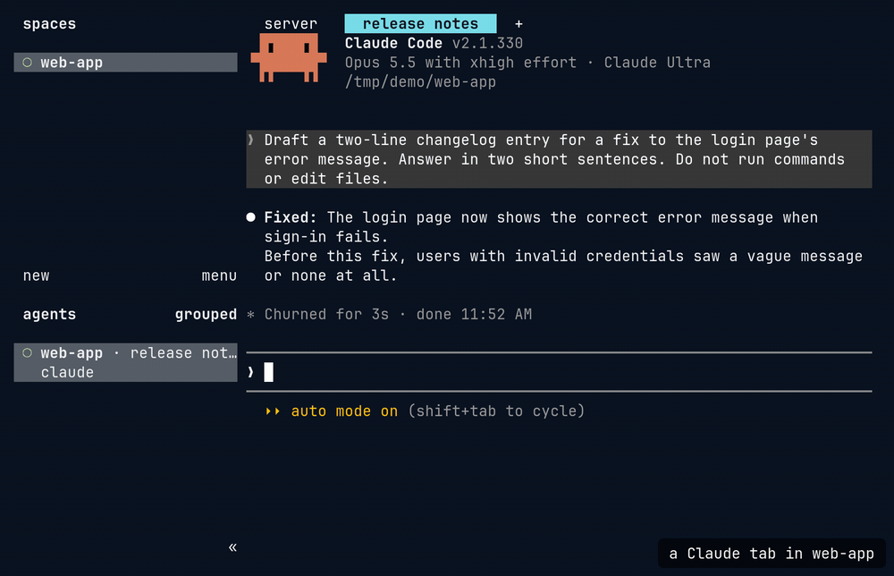

<h1 align="center">
  <picture>
    <source media="(prefers-color-scheme: dark)" srcset="branding/eartag/lockup-dark.svg">
    
  </picture>
</h1>

**Closed agent sessions, filed under their [Herdr](https://herdr.dev) workspace and ready to reopen.** An archive per workspace · reopen in one click · bring back whole workspaces · Claude Code, Codex, Grok and the other agents Herdr knows


Herdr keeps your coding agents in workspaces and tabs. Close a tab, though, and its conversation is gone from Herdr: you're left digging for a session id, and the agent's own resume picker lists sessions by folder, not by the Herdr workspace you were working in. Earmark keeps every closed session filed under its workspace, so one key shows that workspace's archive and Enter brings a conversation back. To earmark something is to set it aside for later; an earmark is also the notch a shepherd cuts to show whose flock a sheep belongs to.



## What you get

- **An archive for each workspace.** Close a tab running an agent, or `/exit` the agent, and its session is filed under the Herdr workspace it was in. Workspaces that share a folder still get separate archives.
- **Reopen in one click.** Ctrl+Space then `a` lists this workspace's closed sessions, newest first. Enter or a double-click opens the session in a new tab with its old name, resuming the conversation where it stopped.
- **Bring back a closed workspace.** Ctrl+Space then Shift+A lists the workspaces you've closed. Restoring one brings back the tabs it had when you closed it, in order, with their names and folders, plain tabs included, and every agent tab resumes its session. Its older archived sessions stay in the archive, so a workspace with 5 open tabs and 70 archived sessions comes back as 5 tabs.

  

- **Your names first.** Each session shows the name you gave its tab (or pane) in bold, with the agent's own title for the session beside it. Reopening gives the tab its name back.
- **Mouse and keyboard.** Click to select, double-click to open, scroll with the wheel, click a row's × to forget it (with Forget and Keep buttons to confirm). Or arrows, Enter, Delete, `/` to filter, Tab to switch between Sessions and Workspaces.
- **Follows each agent's own housekeeping.** For Claude Code, Codex and Grok, Earmark reads the agent's own files (never writes them) for the title, the last activity and whether the session still exists. A session stays in the archive as long as the agent keeps it, and leaves when the agent deletes it, so the archive never offers a dead session.
- **Restarts are safe.** Restarting Herdr's server, or a reboot, doesn't archive anything: Herdr restores those tabs itself.
- **Nothing running in the background.** Earmark is a few short Herdr hooks and a popup, in plain Python with no dependencies.

## Install

```bash
herdr plugin install cwilliams5/herdr-earmark
```

Then bind the archive to keys in Herdr's config (`~/.config/herdr/config.toml`) and run `herdr server reload-config`:

```toml
[[keys.command]]
key = "prefix+a"
type = "plugin_action"
command = "io.github.cwilliams5.earmark.open"
description = "Earmark: archived sessions"

[[keys.command]]
key = "prefix+shift+a"
type = "plugin_action"
command = "io.github.cwilliams5.earmark.open-workspaces"
description = "Earmark: closed workspaces"
```

Any free key works; `prefix+a` and `prefix+shift+a` are unused in Herdr's default keys.

Optionally:

- **Codex:** start it with `codex --no-daemon`. Since 0.157, Codex runs sessions in a shared background daemon, and Herdr then can't tell which tab a Codex session is in ([herdrdev/herdr#4649](https://github.com/herdrdev/herdr/issues/4649)), so Earmark can't file it either. Earmark's own reopen command already uses the flag.
- **An archive count in Herdr's sidebar:** Earmark publishes a `$earmark` token ("3 archived") for each workspace. It shows only if you add it to your sidebar rows:

  ```toml
  [ui.sidebar.spaces]
  rows = [["state_icon", "workspace", { token = "$earmark", dim = true }], ["branch", "git_status"]]
  ```

**Dependencies:** Herdr 0.9.5 or newer and `python3` 3.9 or newer, standard library only.

**What it changes:** only its own two folders, the archive in `~/.local/state/herdr/plugins/io.github.cwilliams5.earmark/` and its settings in `~/.config/herdr/plugins/config/io.github.cwilliams5.earmark/`. It reads the agents' session files but never writes them, and it never edits Herdr's config: the key bindings above are yours to add.

## Uninstall

```bash
herdr plugin uninstall io.github.cwilliams5.earmark
```

Then remove the two `[[keys.command]]` blocks (and the `$earmark` token, if you added it) from Herdr's config, and delete Earmark's two folders listed above. The agents' own conversations are untouched.

## Resources

Earmark has no background process. Its hooks run when Herdr reports an event (a tab focused, an agent starting or finishing, a close), take about 25 ms each, and ran about twice a minute during a working session. Opening the popup checks the archive against the agents' files; each session's file is read once and then only again if it changes, so 300 archived sessions open in under a millisecond.

**Tested with** Herdr 0.9.5, Claude Code 2.1.330, Codex 0.171 and Grok 1.0.92, on Arch Linux (Omarchy), with Python 3.14 and 3.9.

## Known limits

- **No right-click menu entry.** Herdr 0.9.5 doesn't let plugins add to its menus; the popup and its two keys are the way in.
- **Splits aren't restored.** A restored workspace's tabs come back with one pane each.
- **Only sessions closed after you install Earmark** are in the archive, and only sessions Herdr knows: the agent needs Herdr's integration installed (`herdr integration status`).
- **Earmark can't keep a session longer than its agent does.** Claude Code deletes conversations after 30 days of inactivity by default (`cleanupPeriodDays` in its settings).
- **Agents other than Claude Code, Codex and Grok** reopen with Herdr's own resume commands but are untested, and their sessions leave the archive after 30 days rather than following the agent.
- **Codex** needs `--no-daemon` (see Install) until [herdrdev/herdr#4649](https://github.com/herdrdev/herdr/issues/4649) is fixed.
- **Linux and macOS only:** the popup uses Python's `curses`, which Windows lacks. macOS is untested, though Earmark runs on Python 3.9, the version macOS ships.

## Built on

- [Herdr](https://herdr.dev) ([herdrdev/herdr](https://github.com/herdrdev/herdr)): the plugin API, CLI and socket API Earmark runs on, and its table of resume commands per agent, which Earmark's defaults copy.
- Forge, the author's session manager for Windows: Earmark brings its per-project archive of closed sessions to Herdr.
- [douglascorrea/herdr-agent-inbox](https://github.com/douglascorrea/herdr-agent-inbox) showed that closed chats can be kept per workspace and reopened with `claude --resume` through Herdr's public plugin API, and [pedroloch/herdr-undo-close](https://github.com/pedroloch/herdr-undo-close) documented that Herdr's `tab.closed` event carries no tab contents. Ideas only; no code taken.
- The `codex --no-daemon` workaround documented in [herdrdev/herdr#4649](https://github.com/herdrdev/herdr/issues/4649).
- Python's standard library (`curses`, `sqlite3`, `tomllib` where present).

---

The rest of this page is the reference: every setting, how Earmark works, and notes for changing it.

## Settings

Settings live in `config.toml` in Earmark's config folder (`herdr plugin config-dir io.github.cwilliams5.earmark` prints it). The file is optional; every key is.

| Setting | Default | What |
|---|---|---|
| `keep_days` | unset | Forget sessions this many days after their last activity. Unset: sessions of Claude Code, Codex and Grok stay as long as the agent keeps them; other agents' sessions and closed workspaces go after 30 days. `0` keeps everything until the agent's files are gone. |
| `title_first` | `"tab"` | Which name leads in the list: `"tab"` (the name you gave the tab or pane, when there is one) or `"agent"` (the agent's own title). The other is shown dimmed beside it. |
| `report_count` | `true` | Publish the `$earmark` sidebar token. It's only visible if you add it to your sidebar rows. |
| `debug_log` | `false` | Log every hook's event to `events.jsonl` in the state folder. |
| `[resume]` | Herdr's commands | The command that reopens a session, per agent name as Herdr reports it, with `{id}` for the session id. For example `claude = ["claude", "--resume", "{id}"]`. |

`python3 earmark.py check` (in the plugin's folder) prints the settings in effect, any problem with the file, and where the archive is; `python3 earmark.py list` prints the archive.

## How it works

- **Notes, not events.** Herdr's close events say what closed, not what was in it, so on each Herdr event Earmark takes a quick snapshot of panes, tabs and workspaces and compares it with its notes. A noted agent pane that's gone was closed (alone, or with its tab or workspace); an agent that left a pane was exited; a new session in the same pane replaced the old one. Those sessions are archived under their Herdr session and workspace. A session that's open again leaves the archive.
- **Restarts.** After a Herdr server start, restored agent panes briefly report their agent as gone while their resume is pending. Earmark ignores that for a minute after startup.
- **Closed workspaces** are remembered as a unit: the tabs open at the time, in order, with names, folders and agent sessions. Restoring creates the workspace again (or uses an open one with the same name) and resumes each agent tab whose session still exists.
- **Reopening** opens a tab with `herdr tab create` and runs the agent's resume command in it with `herdr pane run`.

## Developing

- Link a working copy instead of installing: `herdr plugin link /path/to/herdr-earmark`. Code changes apply on the next hook or popup; re-link after editing `herdr-plugin.toml`.
- `python3 -m unittest discover tests` runs the unit tests; they never touch Herdr.
- `tests/live_check.sh` runs the whole flow (close, reopen, `/exit`, restart, restore a workspace) against a throwaway named Herdr session with real Claude Code sessions. `EARMARK_AGENTS="codex grok" tests/live_check.sh` adds Codex and Grok.
- Hook errors show in `herdr plugin log list --plugin io.github.cwilliams5.earmark`.

## License

MIT. See [LICENSE](LICENSE).
